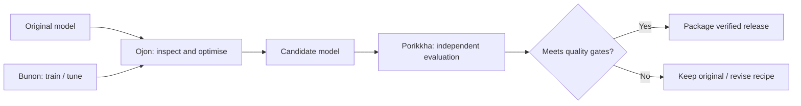

<div align="center">

# Ojon (ওজন)

**Smaller local AI models. More freedom. Measured quality.**

A local-first Rust workstation for **model quantisation, behavioural editing experiments and honest before/after evaluation**.

[](https://github.com/jony100200/Ojon/actions/workflows/rust-check.yml)
[](https://github.com/jony100200/Ojon#project-status)
[](Cargo.toml)
[](LICENSE)

[Quick start](#quick-start) · [Features](#what-ojon-can-do) · [Benchmarks](#evidence-not-hype) · [Documentation](#documentation) · [Contribute](CONTRIBUTING.md)

</div>

---

## Your model. Your hardware. Your trade-offs.

Large models consume memory. Small models can lose accuracy. Behaviour edits can remove unnecessary refusals *and* damage useful abilities.

**Ojon helps you measure the trade-off instead of guessing.** Inspect a local model, plan a compatible workflow, build variants with supported backends, and keep only results that pass your chosen checks.

| **Optimise & quantise** | **Edit behaviour & verify** |
| --- | --- |
| Find GGUF precision options, plan mixed-precision recipes and evaluate quality against the original. | Experiment with reduced over-refusal on supported models, then check coding, reasoning and legitimate-answer retention. |
| **Goal:** a smaller model that fits your target machine. | **Goal:** more useful freedom without unmeasured capability loss. |
| [Recipe search](docs/RECIPE_SEARCH.md) · [Quality strategy](QUALITY_STRATEGY.md) | [Behaviour audit](docs/BEHAVIOUR_QA.md) · [Research limitations](docs/HERETIC_2_RESEARCH.md) |

> **Pre-alpha:** The Rust CLI and Kathamo desktop source are available. Some workflows run with external tools; other model families and automatic editing remain experimental. **There is no downloadable stable release yet.** A successful conversion or an “uncensored” model name is not proof of quality.

## Quick start

You need a working [Rust toolchain](https://rustup.rs/) and, depending on the workflow, an installed compatible model backend.

```bash
git clone https://github.com/jony100200/Ojon.git
cd Ojon

# See installed backends and their capabilities.
cargo run --locked --bin ojon -- backends

# Inspect a local GGUF without running inference.
cargo run --locked --bin ojon -- inspect path/to/model.gguf

# Open the optional Kathamo desktop workstation.
cargo run --locked --features gui --bin ojon-gui
```

For model conversion and quantisation, first check the available tools with `backends`. Supported device IDs and formats depend on your installed versions. Ojon does **not** silently download models or promise every model family will work.

[Full user guide](USER_GUIDE.md) · [Command reference](USER_GUIDE.md) · [Report an issue](https://github.com/jony100200/Ojon/issues/new/choose)

## What Ojon can do

| Capability | Status | What it provides |
| --- | --- | --- |
| GGUF inspection and backend discovery | **Available** | Identify models, installed backends and basic compatibility without loading weights. |
| Quantisation and optimisation workflows | **Available; backend-dependent** | `auto-quant`, precision sweeps, importance-aware and measured mixed-precision recipes. |
| Quality and hardware evidence | **Available; evidence-dependent** | Compare task results, perplexity/KL, output size, peak memory and throughput when measured. |
| Behaviour editing | **Experimental** | GGUF projection and activation-based research workflows, with explicit quality gates. |
| Multimodal and specialist model checks | **Partial** | Image/video diffusion parity, OCR, embeddings, rerankers and Whisper WER on supported backends. |
| MTP and speculative-draft inspection | **Available as preflight** | Detect/preserve MTP components and check draft tokenizer compatibility; not a speed guarantee. |
| Model handoff from Bunon | **Available** | Verify hashes, GGUF metadata and relevant components of Bunon-produced artifacts. |
| Kathamo desktop interface | **Pre-alpha** | Native desktop workflow interface; not yet a polished binary release. |

**Training, dataset curation and distillation belong to [Bunon](https://github.com/jony100200/Bunon).** Legacy Ojon training commands forward to `bunon-learn` when installed. Ojon retains model merging, optimisation and verification. Behaviour-editing code remains partly in Ojon while the research ownership moves to Bunon.

## Evidence, not hype

Our standard is simple: **compare the original, a community alternative and the Ojon candidate using matched prompts, settings and verified output files.**

A serious result records model/source hashes, task-level failures, quality retention, quantisation settings, real runtime load, memory and speed. Screening-only evidence is labelled as screening-only, not as a release certificate.

The latest recorded FrogNano behavioural-editing trial **did not improve measured over-refusal** and was rejected. We publish that limitation rather than claim a win.

- [Community Model Challenge — scope and limitations](docs/COMMUNITY_MODEL_CHALLENGE.md)
- [FrogNano two-sided editing trial — rejected result](docs/FROGNANO_TWO_SIDED_ACTIVATION_TEST_2026_11_02.md)
- [Quality acceptance rules](QUALITY_STRATEGY.md)

## How the projects fit together



Ojon can run its own screening and quality checks; **independent** benchmark verification is Porikkha's responsibility. Twarok and compatible inference backends handle runtime execution, where supported.

## Project status

Ojon is actively developed as an **open-source pre-alpha** project. No universal support, fully automatic uncensoring result or performance superiority is claimed. We prioritise:

1. Repeatable quantisation results with measured quality per GB.
2. Reliable before/after behaviour evaluation and safe rollback.
3. Better first-run experience, architecture coverage and tested desktop binaries.
4. Publishable reports, model cards and reproducible releases.

**Want to help?** Try a documented workflow, file a reproducible [bug report](https://github.com/jony100200/Ojon/issues/new/choose), suggest a model/backend, or contribute a fix. See [CONTRIBUTING.md](CONTRIBUTING.md).

## Documentation

| Start here | Technical details |
| --- | --- |
| [User guide](USER_GUIDE.md) | [Recipe search](docs/RECIPE_SEARCH.md) |
| [Quality strategy](QUALITY_STRATEGY.md) | [Behaviour evaluation](docs/BEHAVIOUR_QA.md) |
| [Community challenge](docs/COMMUNITY_MODEL_CHALLENGE.md) | [Product differentiation](docs/PRODUCT_DIFFERENTIATION.md) |
| [Contributing](CONTRIBUTING.md) | [Security reporting](SECURITY.md) |

---

<div align="center">

**Less memory. More models. Measured results.**

Developed by [Kalponic Studio](https://github.com/jony100200) · [Issues](https://github.com/jony100200/Ojon/issues) · [GitHub Actions](https://github.com/jony100200/Ojon/actions)

</div>
